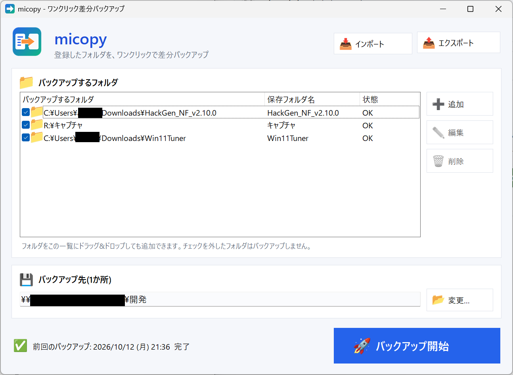
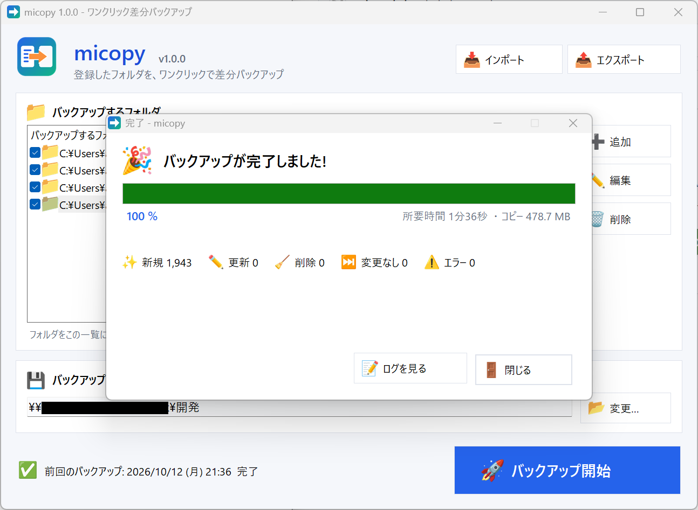

# micopy

**登録したフォルダを、ワンクリックで差分バックアップ** する Windows 11 用のシンプルなバックアップアプリです。

.NET Framework 4.8(Windows 11 に標準搭載)だけで動き、外部ライブラリは使っていません。`micopy.exe` 1つで動きます。



## 特長

- 📁 バックアップしたいフォルダを複数登録(ドラッグ&ドロップでも登録可)
- 🚀 ボタン1つでバックアップ。2回目以降は変わったファイルだけをコピー
- 🧹 バックアップ元で消したファイルやフォルダは、バックアップ先からも削除(ミラー)
- 📊 プログレスバーで進み具合と残り時間を表示
- 📤 設定のエクスポート/📥 インポート
- 🖥️ マルチディスプレイ環境では、前回閉じたディスプレイで起動

> [!NOTE]
> 個人で開発しているプロジェクトのため、Issue と Pull Request は受け付けていません。ご了承ください。

## ダウンロード

[Releases](https://github.com/onboard-dev/micopy/releases) から最新の `micopy.exe` をダウンロードして、好きなフォルダに置いて実行してください。インストールは不要です。

> 署名のない実行ファイルのため、初回起動時に Windows SmartScreen の警告が出ることがあります。「詳細情報」→「実行」で起動できます。

## 使い方

1. 「➕ 追加」でバックアップしたいフォルダを登録します
2. 「📂 変更…」でバックアップ先(外付けドライブなど)を選びます
3. 「🚀 バックアップ開始」を押します(F5 キーでも開始できます)

バックアップ中はプログレスバーで進み具合と残り時間が表示され、終わると結果の画面になります。
新規・更新・削除・変更なし・エラーの件数と所要時間が表示され、「📝 ログを見る」でコピーや削除をしたファイルの一覧(実行ログ)も確認できます。



- バックアップ先には `バックアップ先\保存フォルダ名\…` の形で、フォルダごとに保存されます
- 1回目はすべてのファイルをコピーし、2回目以降は「新しいファイル」と「サイズか更新日時が変わったファイル」だけをコピーします
- チェックを外したフォルダは、一時的にバックアップの対象から外れます

## 安全のための動き

- バックアップ元のフォルダが見つからないとき(USBメモリを挿していないときなど)は、そのフォルダをスキップし、バックアップ先は削除しません
- 読み取れないサブフォルダがあったときは、バックアップ先にある対応フォルダを消さずに残します
- バックアップ先とバックアップ元が重なる設定(入れ子)は、登録の時点で止めます
- 削除(ミラー)の対象は `バックアップ先\保存フォルダ名` の中だけです。それ以外のファイルには触れません
- ジャンクションやシンボリックリンクはたどりません(無限ループを防ぐため)
- FAT32 / exFAT のドライブでは更新日時が2秒単位になるため、2秒以内の差は「変更なし」として扱います
- コピーはいったん一時ファイル(`*.micopy_tmp`)に書いてから置き換えるので、途中で中止しても壊れたファイルは残りません

## 設定とログ

| 内容 | 場所 |
|---|---|
| 設定ファイル | `%APPDATA%\micopy\settings.xml` |
| 実行ログ(新しいものから30件) | `%APPDATA%\micopy\logs\` |

エクスポートでは、登録フォルダとバックアップ先を XML ファイルに書き出します。インポートすると、今の設定と置き換わります。

## 開発者向け

### フォルダ構成

```
src\          C# ソース(C# 5 の書き方。Windows 標準の csc.exe でビルドできます)
res\          アイコン、カラー絵文字の画像(EXE に埋め込み)、マニフェスト
doc\          README 用の画像
tools\        各バッチから呼ばれる PowerShell スクリプト
VERSION       現在のバージョン番号
```

### バッチファイル

| ファイル | 内容 | 必要なもの |
|---|---|---|
| `build.bat` | `bin\micopy.exe` をビルド | なし(Windows 標準の csc.exe を使用) |
| `version.bat` | ダイアログでバージョン番号(例: `1.2.0`)を入力。`VERSION` と `src\Version.cs` を書き換え、続けてビルドもできます。番号はアプリのタイトルバーと画面上部に表示されます | なし |
| `commit.bat` | 変更をコミットして GitHub へプッシュ。コミット前に個人情報チェックを行い、コミットメッセージはダイアログで入力します。初回はリポジトリの準備も自動で行います | [Git for Windows](https://gitforwindows.org/) |
| `release.bat` | ビルド → 未コミットの変更をコミット&プッシュ → タグ `v<バージョン>` と GitHub Release を作成し、`micopy.exe` を登録 | Git for Windows、[GitHub CLI](https://cli.github.com/)(初回に `gh auth login`) |

リリースの流れ: `version.bat` で番号を上げる → `release.bat`

### コミット前の個人情報チェック

`commit.bat`(と `release.bat` から行うコミット)では、追加・変更された行とファイル名を調べ、次のようなものが見つかると一覧を表示して確認します。

- メールアドレス、電話番号、郵便番号、ローカル IP アドレス
- `C:\Users\<名前>\…` のようなユーザーフォルダのパス、この PC のユーザー名・コンピューター名
- GitHub トークン、AWS キー、秘密鍵、パスワードらしき記述
- 秘密鍵ファイルや micopy の設定ファイル・ログファイル
- `tools\privacy-words.txt` に書いた言葉(氏名・学校名・住所など。このファイルは GitHub に上がりません)

画像ファイルは中身を検査できないため、追加・変更があるときは「写り込みがないか」を確認します。
また、コミットに記録されるメールアドレスが GitHub の noreply アドレスでない場合は、初回に確認します。
問題ないと分かっている文字列は `tools\privacy-allow.txt` に書くと、次回から報告されなくなります。

## ライセンス

[GNU General Public License v3.0](LICENSE)

カラー絵文字の画像は [Noto Color Emoji](https://github.com/googlefonts/noto-emoji)(SIL Open Font License 1.1)から作成しています。
